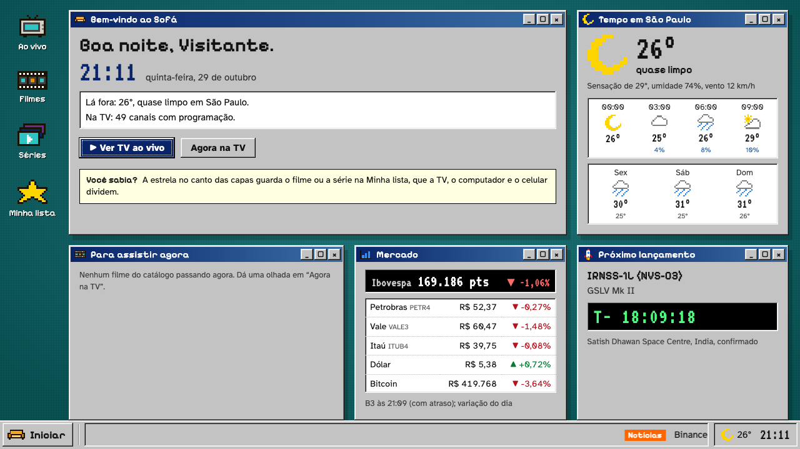
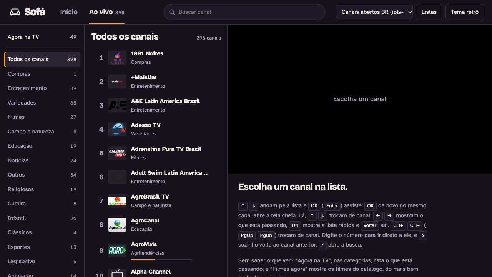

# Sofá

Um player de listas IPTV para a sua casa. Ele roda num computador que fica ligado e abre no navegador da TV, do próprio computador e do celular, todos no mesmo Wi-Fi. Foi feito para o controle remoto e testado numa TV LG com webOS, mas também funciona com mouse, teclado e toque.





## O que ele faz

- **TV ao vivo** com guia de programação, canais numerados, categorias em português e "Agora na TV", que mostra o que está passando em cada canal.
- **Um canal, várias versões.** Quando a lista traz o mesmo canal em FHD, HD e SD, ele vira um só. Se a versão que está tocando travar, o Sofá passa sozinho para outra.
- **Filmes e séries** com "Continuar assistindo", "Minha lista", nota e sinopse. Isso aparece com listas Xtream (veja abaixo).
- **Início** com bem-vindo, previsão do tempo da sua cidade, Ibovespa e ações da B3, dólar, euro, bitcoin, o próximo lançamento de foguete e manchetes de tecnologia.
- **Dois temas:** o retrô ("Sofá 98", uma área de trabalho dos anos 90) e o moderno. Cada aparelho escolhe o seu.
- **Economiza a conexão da lista:** se ninguém está vendo (a aba ficou escondida por 10 minutos), o vídeo para. Depois de 3 horas no mesmo canal, ele pergunta "Ainda está assistindo?".

## Do que você precisa

- **Um computador que fique ligado** enquanto vocês assistem: Mac, Linux ou Windows.
- **Python 3.9 ou mais novo.** Não precisa instalar mais nada (o Sofá só usa o que já vem com o Python).
  - Mac: abra o Terminal e digite `python3 --version`. Se o Mac oferecer instalar as "ferramentas de linha de comando", aceite: o Python vem junto.
  - Windows: instale pelo [python.org](https://www.python.org/downloads/) e marque "Add python.exe to PATH" na primeira tela.
  - Linux: quase sempre já vem instalado.
- **A TV, o celular e o computador no mesmo Wi-Fi** (ou no mesmo roteador).
- **Uma lista IPTV:** um link `.m3u`/`.m3u8`, um arquivo `.m3u` ou o link de uma conta Xtream. Para testar, o Sofá já vem com uma lista de canais abertos.

## Instalar e ligar

Com git:

```sh
git clone https://github.com/matheushchaves/iptv.git
cd iptv
python3 server.py
```

Sem git: no GitHub, clique em **Code → Download ZIP**, descompacte, abra o terminal dentro da pasta e rode `python3 server.py` (no Windows, `py server.py`).

O terminal mostra os endereços:

```
IPTV rodando em http://localhost:8000 e, na rede, http://192.168.1.50:8000
```

Deixe o terminal aberto enquanto estiverem assistindo. Para desligar, aperte `Ctrl+C`. Para usar outra porta: `python3 server.py 8080`.

Na primeira vez, o computador pode perguntar se o Python pode receber conexões. No Mac, clique em **Permitir**. No Windows, permita em **Redes privadas**. Sem isso, a TV e o celular não conseguem abrir a página.

## Abrir em cada aparelho

| Aparelho | O que fazer |
|---|---|
| O computador que roda o Sofá | Abra `http://localhost:8000` no navegador. |
| TV | Abra o navegador da TV (na LG, o app **Navegador da Web**) e digite o endereço "na rede", por exemplo `http://192.168.1.50:8000`. Salve nos favoritos para não digitar de novo. Na TV, o Sofá já abre tocando o último canal. |
| Celular ou tablet | Abra o mesmo endereço "na rede" no navegador. Dá para pôr na tela de início como se fosse um app (no iPhone: Compartilhar → Adicionar à Tela de Início). |
| Outro computador da casa | O mesmo endereço "na rede". |

O endereço "na rede" pode mudar quando o roteador reinicia. Para ele ficar fixo, reserve um IP para o computador nas configurações do roteador (procure por "reserva de DHCP" ou "IP fixo").

Favoritos, "Minha lista" e "Continuar assistindo" ficam guardados no computador que roda o Sofá, então aparecem iguais em todos os aparelhos. O tema e o som da entrada são de cada aparelho.

A TV testada é uma LG com webOS (2021, navegador baseado no Chrome 79). Outras TVs com navegador devem abrir a página, mas não foram testadas, e os botões do controle podem chegar diferentes.

## Colocar a sua lista

Clique em **Listas** (em cima, ou no menu Iniciar do tema retrô), dê um nome e escolha:

- **Link:** o endereço da lista, como `https://exemplo.com/lista.m3u8`.
- **Arquivo:** um `.m3u` do computador, de até 300 MB.

**Conta Xtream:** use o link M3U que o seu provedor passa, no formato
`http://servidor:porta/get.php?username=USUARIO&password=SENHA&type=m3u_plus&output=ts`.
Com ele, além da TV ao vivo, aparecem Filmes, Séries, notas, sinopses, a data de vencimento da conta e "Minha lista".

Muitas contas Xtream só deixam uma tela assistir por vez: se a TV está tocando, o celular recebe recusa. É por isso que o Sofá para o vídeo quando ninguém está vendo.

Para trocar de lista, use o menu ao lado do botão **Listas**.

As listas ficam no arquivo `playlists.json`, só no computador que roda o Sofá. A tela mostra o servidor da lista, mas nunca o usuário e a senha, e o registro do servidor também não grava esses dados.

## Listas para testar

Canais públicos e gratuitos, transmitidos pelos próprios donos na internet. A primeira já vem no Sofá. Para as outras, copie o link em **Listas → Link**.

| Lista | Canais | Link |
|---|---|---|
| Canais abertos do Brasil (iptv-org) | ~400 | `https://iptv-org.github.io/iptv/countries/br.m3u` |
| Canais em português, do Brasil, de Portugal e de outros países (iptv-org) | ~480 | `https://iptv-org.github.io/iptv/languages/por.m3u` |
| Free-TV, só canais gratuitos, do mundo todo | ~2.000 | `https://raw.githubusercontent.com/Free-TV/IPTV/master/playlist.m3u8` |
| Free-TV, só os do Brasil (pequena, boa para um teste rápido) | ~10 | `https://raw.githubusercontent.com/Free-TV/IPTV/master/playlists/playlist_brazil.m3u8` |

Canais públicos saem do ar de vez em quando, então é normal alguns não tocarem. Essas listas só têm TV ao vivo. Filmes e séries só aparecem com uma conta Xtream.

O guia de programação vem do [epg.pw](https://epg.pw) e cobre os canais brasileiros.

## Controle remoto e teclado

| Controle da TV | Teclado | O que faz |
|---|---|---|
| ↑ ↓ ← → | setas | andam pela tela |
| OK | Enter | assiste; OK de novo no mesmo canal abre a tela cheia |
| CH+ / CH− | PgUp / PgDn | troca de canal |
| números | números | vai direto ao canal; o 0 sozinho volta ao canal anterior |
| Voltar | Esc | sai da tela cheia e fecha menus |
| | F | abre e fecha a tela cheia |
| | / | abre a busca |

Em tela cheia, no ao vivo:

- OK abre a lista rápida de canais por cima do vídeo;
- ↑ e ↓ trocam de canal;
- ← e → mostram o que está passando e o que vem depois.

No celular, é só tocar.

## Temas e entrada

Troque o tema pelo botão **Tema retrô / Tema moderno**, em cima, ou pelo menu Iniciar do tema retrô. Cada aparelho guarda o seu.

A entrada (a tela de abertura com os números do dia) aparece na primeira vez do dia em cada aparelho. Qualquer tecla ou toque pula. O som da entrada liga e desliga no menu Iniciar do tema retrô. O navegador pode não deixar tocar som antes de você apertar alguma coisa: nesse caso a entrada fica muda, e "Reiniciar o Sofá", no menu Iniciar, toca normalmente.

## Segurança

- **O Sofá só atende a rede de casa.** Pedidos que chegam da internet são recusados. Não abra a porta 8000 no roteador. Para assistir fora de casa, use uma VPN como o [Tailscale](https://tailscale.com), que o Sofá aceita.
- **Não tem senha.** Qualquer pessoa no Wi-Fi da casa pode abrir o Sofá e mexer nas listas. Se você empresta o Wi-Fi para visitas, use uma rede de visitantes separada.
- **As senhas das listas não saem do computador.** O `playlists.json`, a pasta `uploads/` e o `prefs.json` estão no `.gitignore` e nunca vão para o GitHub.

## Quando algo não funciona

- **A TV não abre a página.** Confira se a TV e o computador estão no mesmo Wi-Fi e se o computador deixou o Python receber conexões (veja "Instalar e ligar"). Teste o endereço no celular primeiro. Se o endereço mudou, olhe o terminal de novo.
- **Um canal não toca.** O canal pode estar fora do ar. Se o canal tem outras versões, escolha outra na tela do canal. Canais em H.265 (HEVC) não tocam no navegador, por isso o Sofá esconde essas versões. Filmes em `.avi` também não tocam no navegador.
- **O celular recebe recusa enquanto a TV toca.** Muitas contas Xtream só aceitam uma tela por vez. Pare o vídeo na TV.
- **A página parece desatualizada.** Quando o código do Sofá muda ou o servidor reinicia, a página se atualiza sozinha quando nada está tocando e ela está no Início. Se ficou presa numa versão muito antiga, recarregue a página uma vez.

## Para quem quer mexer no código

Não tem build nem dependências. O servidor é Python puro, e a página é HTML, CSS e módulos JavaScript servidos como estão.

| Arquivo | O que tem |
|---|---|
| `server.py` | servidor HTTP: listas, catálogo, guia de programação e o proxy dos vídeos |
| `catalog.py` | lê a lista e junta as versões de cada canal |
| `xtream.py` | conversa com o painel Xtream (com cache e limite de pedidos) |
| `vodmatch.py` | liga a programação dos canais de filmes ao catálogo (nota e sinopse) |
| `desk.py` | os dados do início: tempo, mercado, foguetes e manchetes |
| `prefs.py` | favoritos, "Minha lista" e "Continuar assistindo" |
| `index.html`, `static/` | a página: `static/js/main.js` liga tudo; `theme-retro.css` e `theme-modern.css` são os temas |

Para rodar os testes:

```sh
python3 -m unittest -q
```

A TV LG de 2021 usa um navegador baseado no Chrome 79. Por isso o JavaScript não usa `?.` nem `??`, e o CSS evita `gap` em flex e `inset`.

Os dados do início vêm de serviços gratuitos que não pedem cadastro:

- a cidade, pelo IP da internet de casa: [ip-api](https://ip-api.com);
- o tempo: [Open-Meteo](https://open-meteo.com);
- câmbio e criptomoedas: [AwesomeAPI](https://docs.awesomeapi.com.br);
- Ibovespa e ações: B3;
- lançamentos de foguetes: [The Space Devs](https://thespacedevs.com);
- manchetes: RSS do Tecnoblog, Canaltech, TecMundo e Meio Bit.

O player de vídeo é o [hls.js](https://github.com/video-dev/hls.js), carregado de uma CDN.

## Aviso

O Sofá é só o player. Ele não vem com canais pagos e não indica onde conseguir listas. Use apenas listas que você tem o direito de assistir.

## Licença

[MIT](LICENSE).
